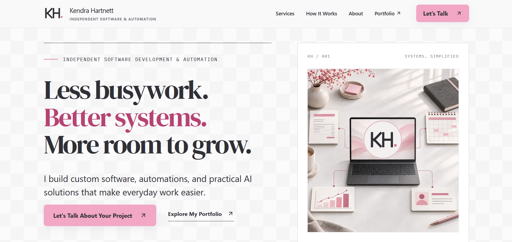

# Kendra Hartnett — Independent Software & Automation

**Author:** Kendra Hartnett

## What I built

**Less busywork. Better systems. More room to grow.**

I built this website for my independent software and automation practice. It shows how I help businesses with custom software, automations, and practical AI solutions that make everyday work easier.

- **Custom Software:** Useful digital tools built around your business.
- **Business Automation:** Connected workflows that take repetitive work off your plate.
- **Practical AI:** AI features that solve a clear problem and fit the way you work.

The site explains my process from discovery to launch, links to [my portfolio](https://kendrahartnett.com/), and gives prospective clients a project inquiry form.

## Why I built it

Every project starts with the problem, then the right tools to solve it. I wanted a clear place to show the work I do and make it easy for businesses to start a conversation about what they need.
